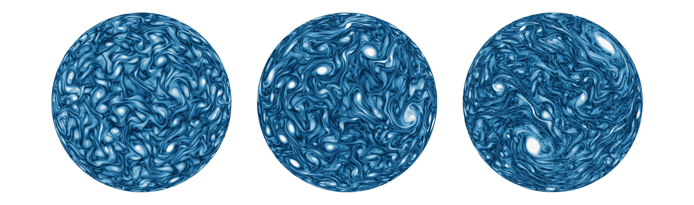
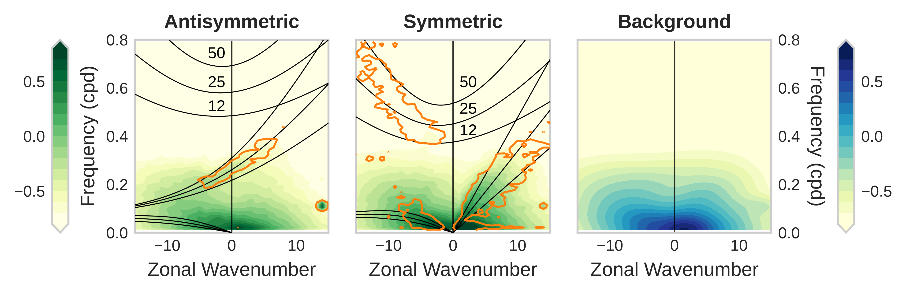
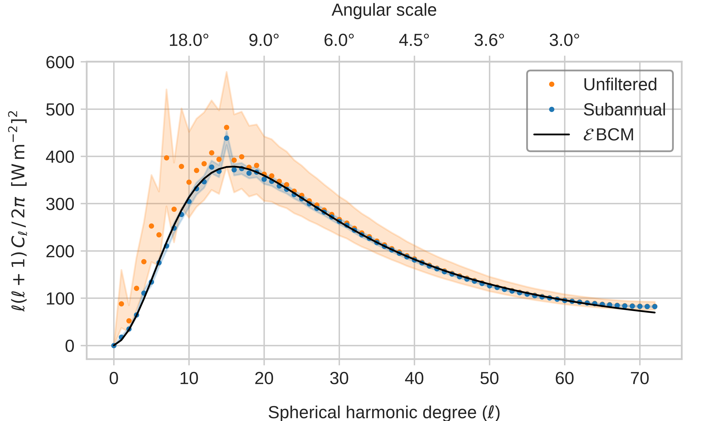
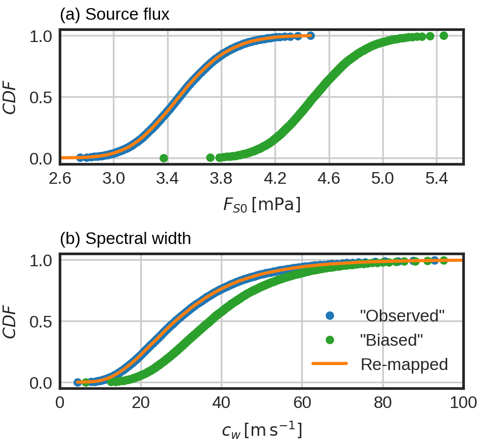
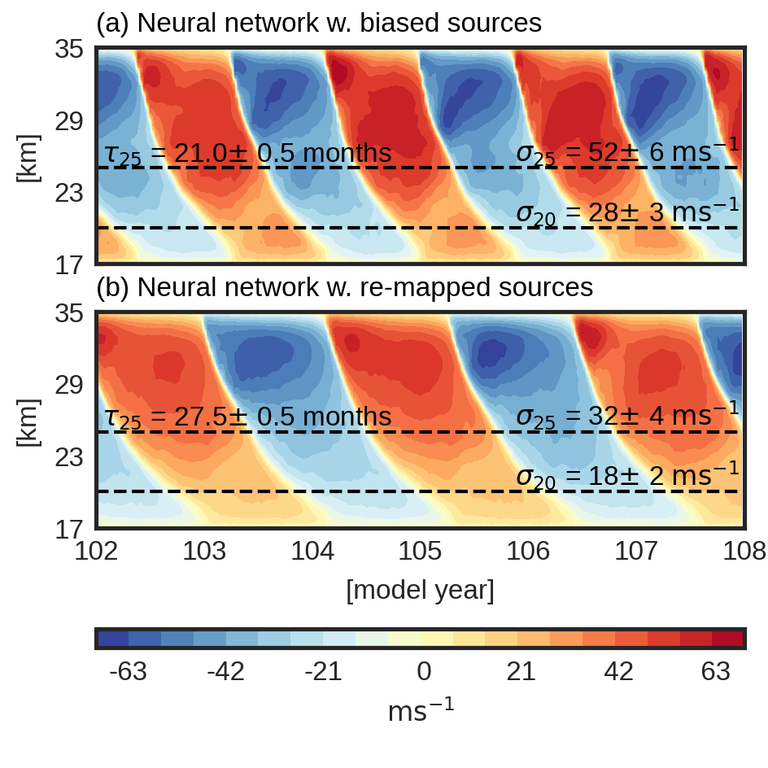
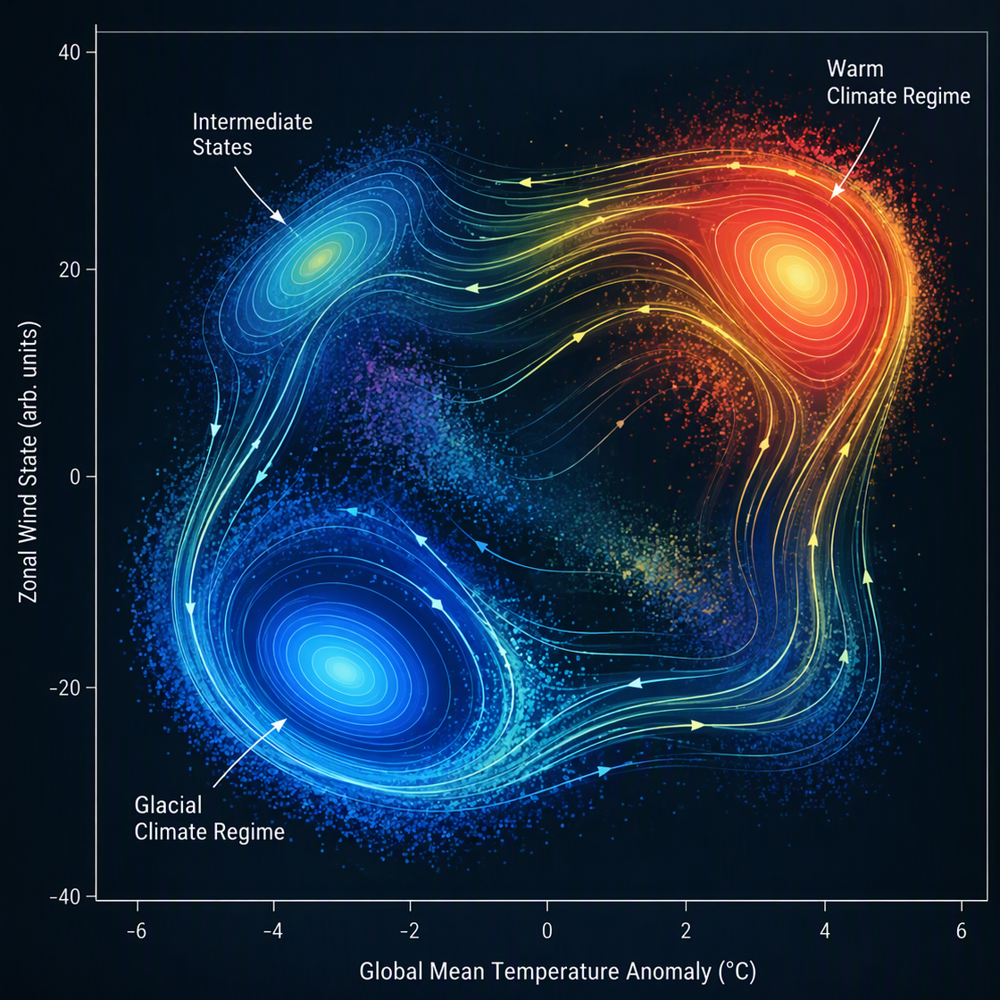

  My research lies at the intersection of atmospheric and climate dynamics,
  geophysical fluid dynamics, and applied mathematics. I use analytic theory,
  observations, stochastic and statistical methods, and numerical models of
  varying complexity to investigate how organized variability arises and how
  faithfully it is represented. A recurring aim is to make assumptions about
  complex geophysical systems explicit and testable, whether those assumptions
  concern wave structure, model approximation, statistical homogeneity, random
  variability, or data-driven parameterization.

<nav class="research-index" aria-label="Research themes">
  <a href="#waves-on-the-sphere">
    Waves, instabilities, and forced dynamics on the sphere
  </a>
  <a href="#organized-atmospheric-variability">
    Organized atmospheric variability
  </a>
  <a href="#climate-model-development">
    Climate model development and evaluation
  </a>
  <a href="#beyond-state-distributions">
    Beyond state distributions
  </a>
</nav>

<section class="research-theme" id="waves-on-the-sphere">
  

## Waves, instabilities, and forced dynamics on the sphere

  

  <figure class="research-figure research-figure--transparent">
    
    <figcaption>
      As the Reynolds number increases (to the right), the vorticity becomes more intermittent, with a small number of intense vortex cores emerging from a weaker filamentary background.
    </figcaption>
  </figure>

  

Waves and instabilities provide a fundamental framework for understanding atmospheric and oceanic motion, but familiar theories often rely on local approximations, asymptotic limits, or restricted parameter regimes. My research has developed and used global solutions of the shallow-water equations to examine how these structures behave on the rotating spherical Earth. This work includes classifying planetary-wave solutions, deriving asymptotic approximations, quantifying the stability of zonal jets across dynamical approximations, and extending the Matsuno–Gill framework beyond its conventional regime. Together, these studies establish when familiar descriptions remain valid, identify where they fail, and reveal how spherical geometry and divergent dynamics alter atmospheric responses.

<!-- [Related publications](/publications/) -->

  

  <a href="#" class="research-back-to-top">↑ Top</a>
</section>

<section class="research-theme" id="organized-atmospheric-variability">
  

## Organized atmospheric variability

  

  <figure class="research-figure research-figure--transparent">
    
    <figcaption>
      Tropical wavenumber–frequency spectrum, adapted from Wheeler and Kiladis (1999).
    </figcaption>
  </figure>

  

Atmospheric spectra contain recognizable waves and other organized structures embedded in a broad background of variability across spatial and temporal scales. Interpreting these spectra requires determining which features reflect distinct dynamics and which can arise from turbulence or random fluctuations. Across this work, I have examined several sources of atmospheric organization. I have shown how nonlinear wave interactions generate large-scale tropical variability and contribute to the observed concentration of power near theoretical wave modes. I have also established a pervasive preference for meridionally symmetric variability and investigated its origins in forcing, nonlinear interactions, eigenstructures, and the statistics of random fields. Extending this inquiry to stochastic variability, I have developed a physics-based model of Earth’s infrared background that provides an objective null hypothesis for identifying organized signals in outgoing longwave radiation.

  

  <figure class="research-figure research-figure--transparent research-figure--secondary">
    
    <figcaption>
      Angular power spectrum of global-scale outgoing longwave radiation.
    </figcaption>
  </figure>

  <!-- [Related publications](/publications/) -->

  <a href="#" class="research-back-to-top">↑ Top</a>
</section>

<section class="research-theme" id="climate-model-development">
  

## Climate model development and evaluation

  

  

Climate models represent interacting processes across a wide range of scales, making it essential to determine whether an apparently realistic simulation is produced by the correct dynamics. My research has addressed this problem through quantitative model tests, model hierarchies, and controlled perturbation experiments. I developed spectral shallow-water solvers based on physically relevant wave eigenfunctions and analytic test cases that provide demanding quantitative evaluations of global dynamical cores. Another focus of this research is whether data-driven gravity-wave parameterizations trained in one environment remain reliable when coupled to a biased model or applied under a different climate.

<!-- This question forms part of my broader interest in the representation of gravity-wave forcing and the quasi-biennial oscillation in climate models. -->

The figures below show how optimal transport can correct biases in gravity-wave source distributions, allowing the expected QBO amplitude and period to be recovered.

  

  

    <figure class="research-figure research-figure--transparent research-figure--paired">
      

        
      

      <figcaption>
        Optimal-transport correction of biased gravity-wave source distributions.
      </figcaption>
    </figure>
    <figure class="research-figure research-figure--transparent research-figure--paired">
      

        
      

      <figcaption>
        QBO simulations with biased and corrected gravity-wave sources.
      </figcaption>
    </figure>
  

  <!-- [Related publications](/publications/) -->

  <a href="#" class="research-back-to-top">↑ Top</a>
</section>

<section class="research-theme" id="beyond-state-distributions">
  

## Beyond state distributions

  

  

Conventional statistical descriptions of climate variability emphasize which states occur and how frequently they occur, providing only a partial account of the underlying dynamics. For example, a state distribution may indicate distinct cold and warm climate regimes while revealing little about the dynamics connecting them. My emerging research explores how data-driven methods can characterize climate state space more fully by recovering information about both its structure and its evolution. I am investigating whether this broader perspective can reveal dynamical model biases that remain hidden when observations and simulations are compared using conventional climate statistics alone.

  

  <figure class="research-figure research-figure--square">
    
    <figcaption>
      Conceptual illustration of climate-state occupancy and dynamical evolution.
      State distributions identify frequently occupied regimes, while the
      pathways between them contain additional dynamical information.
    </figcaption>
  </figure>

  <a href="#" class="research-back-to-top">↑ Top</a>
</section>
