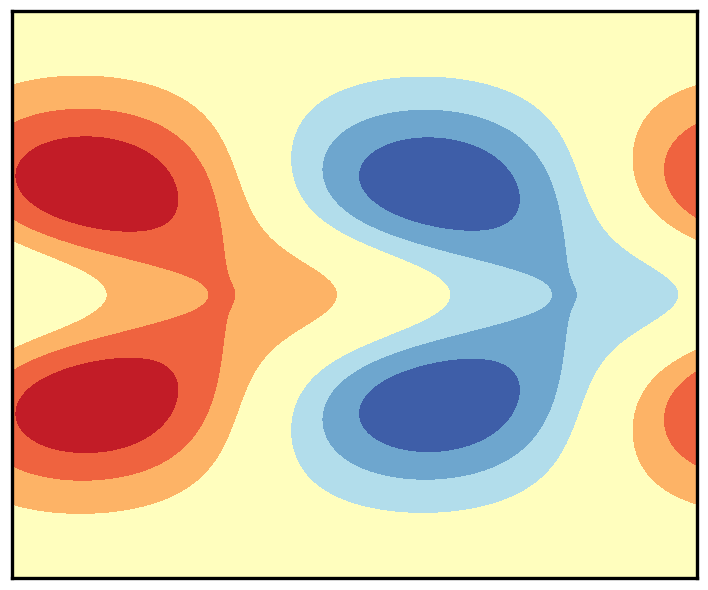

My research lies at the intersection of atmospheric and climate dynamics, geophysical fluid dynamics, and applied mathematics. I use analytic theory, observations, stochastic and statistical methods, and numerical models of varying complexity to investigate how organized variability arises and how faithfully it is represented. A recurring aim is to make assumptions about complex geophysical systems explicit and testable, whether those assumptions concern wave structure, model approximation, statistical homogeneity, random variability, or data-driven parameterization.

  

    
  

  

## Waves, instabilities, and forced dynamics on the sphere

Waves and instabilities provide a fundamental framework for understanding atmospheric and oceanic motion, but familiar theories often rely on local approximations, asymptotic limits, or restricted parameter regimes. My research has developed and used global solutions of the shallow-water equations to examine how these structures behave on the rotating spherical Earth. This work includes classifying planetary-wave solutions, deriving asymptotic approximations, quantifying the stability of zonal jets across dynamical approximations, and extending the Matsuno–Gill framework beyond its conventional regime. Together, these studies establish when familiar descriptions remain valid, identify where they fail, and reveal how spherical geometry and divergent dynamics alter atmospheric responses.

[Related publications](/publications/)

  

  

    
  

  

## Dynamical structure and random variability in atmospheric spectra

Observed atmospheric spectra contain recognizable waves and other organized structures embedded in a broad background of variability. Interpreting these spectra requires determining which features reflect distinct dynamics and which can arise from turbulence or random fluctuations. My work has shown how nonlinear wave interactions generate large-scale tropical variability and contribute to the observed concentration of power near theoretical wave modes. I have also established a pervasive preference for meridionally symmetric variability and investigated its origins in forcing, nonlinear interactions, eigenstructures, and the statistics of random fields. More recently, I developed a physics-based stochastic model of Earth's infrared background that provides an objective null hypothesis for identifying organized signals in outgoing longwave radiation.

[Related publications](/publications/)

  

  

    
  

  

## Evaluating and improving representations of atmospheric dynamics

Climate models represent interacting processes across a wide range of scales, making it essential to determine whether an apparently realistic simulation is produced by the correct dynamics. My research has addressed this problem through quantitative model tests, model hierarchies, and controlled perturbation experiments. I developed spectral shallow-water solvers based on physically relevant wave eigenfunctions and analytic test cases that provide demanding quantitative evaluations of global dynamical cores. More recently, I investigated the sensitivity of the quasi-biennial oscillation to resolution, diffusion, resolved waves, and parameterized gravity waves, and examined whether data-driven gravity-wave parameterizations trained in one environment remain reliable when coupled to a biased model or applied under a different climate.

[Related publications](/publications/)

  

  

    
  

  

## Beyond state distributions: probability transport in climate dynamics

Statistical descriptions of climate variability commonly characterize which states occur and how frequently they occur, but not how the system moves between them. My emerging research addresses this limitation by combining state distributions with directional probability currents, which quantify net probability transport and broken detailed balance in nonequilibrium systems. I aim to develop physically constrained, data-driven methods for estimating these quantities from observations and climate-model simulations, and to use them to diagnose model bias, forced change, and extreme-event pathways. Related work examines assumptions underlying statistical analyses of global fields, including how apparent spatial homogeneity depends on observational resolution and sampling.

  

